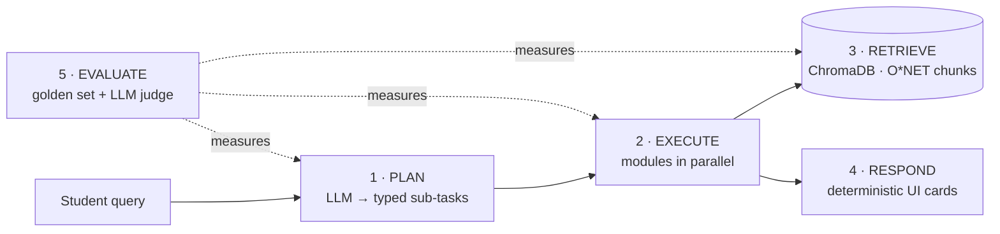

<div align="center">


# **Elevatr**

**A career copilot for students: ask one question, and an agent routes it to the right tools, grounded in real occupational data.**

`FastAPI` · `LangChain` · `Ollama / GPT-4o` · `ChromaDB` · `Sentence-Transformers` · `MongoDB Atlas` · `React 18 + TypeScript`

</div>


> This README is a **10-minute guided walkthrough**: each stop names the file to open, what it does, and the concept it shows.
> Full design doc (diagrams, trade-off tables, LLM inventory): **[docs/DESIGN.md](docs/DESIGN.md)**.

---

## Overview

Students juggle a resume tool, a job board, interview prep and grad-school research, and none of them know what a target role actually requires.
In Elevatr a student types one request. An **orchestrator** asks an LLM for a typed plan, runs only the needed modules **in parallel**,
and grounds them in a **RAG index of O\*NET occupation data**. An **eval harness** with **LLM-as-a-judge** measures whether each step works.



---

## Walkthrough: 7 stops


### Planning: the LLM makes a typed plan · [orchestrator.py](backend/orchestrator.py#L368)
| Code | What it does |
|---|---|
| [`SubTask` / `Decomposition`](backend/orchestrator.py#L167) | Pydantic schema of the plan: a list of `{module, typed inputs}`. |
| [`decompose()`](backend/orchestrator.py#L368) | Sends planner prompt + profile + last 6 chat turns; `with_structured_output(Decomposition)` makes the LLM answer in that schema. |
| [`compact_student_profile()`](backend/orchestrator.py#L98) | Trims profile fields to 1,200 chars → bounded prompt size and cost. |
| [decomp_prompt.j2](backend/prompts/decomp_prompt.j2) | The planner's rules: only relevant modules, never invent fields. |

**Concepts:** *structured output* (no regex parsing; invalid plans fail validation) · *context budgeting*.


###  Execution: parallel, fault-isolated · [`run()`](backend/orchestrator.py#L395)
| Code | What it does |
|---|---|
| `asyncio.TaskGroup` + `asyncio.timeout(120)` | Runs every sub-task concurrently; latency ≈ the slowest module, not the sum. |
| [`safe_execute_module()`](backend/orchestrator.py#L242) | Catches a module's exception and returns it as that module's `error`, so one failure can't cancel the others. |
| [`build_ui_payload()`](backend/orchestrator.py#L353) | Shapes results into cards **without a second LLM call**: no extra latency, no hallucination surface. |


### Data & chunking · [rag/chunking.py](backend/rag/chunking.py) → [ingest_mongo.py](backend/rag/ingestion/ingest_mongo.py#L71)
| Code | What it does |
|---|---|
| [`build_onet_chunk()`](backend/rag/chunking.py#L106) | **One occupation = one chunk**: `Job Title / Description / Skills / Knowledge / Tasks`, plus metadata `{title, source, mongo_id}`. |
| [`parse_list_field()`](backend/rag/chunking.py#L46) | Normalises skills from two sources with different formats (list of dicts vs list of strings). |
| [`ingest_all()`](backend/rag/ingestion/ingest_mongo.py#L71) | MongoDB → chunk → embed (`all-MiniLM-L6-v2`, 384-d) → ChromaDB (cosine). Drops and rebuilds the collection on each run, so re-running never duplicates chunks. |

**What's indexed:** 38 O\*NET occupations + 200 career-rec records = **238 chunks**. Resumes are *parsed* into a profile, **not** embedded; the profile becomes the *query*.
**Concepts:** *record-level chunking* (fixed windows would split an occupation from its title) · *title anchoring* · the embedder only reads **256 tokens**, so fields are ordered most-important-first.

### Retrieval · [`query_jobs()`](backend/rag/retriever.py#L33)
| Code | What it does |
|---|---|
| [`retrieve_for_resume()`](backend/rag/retriever.py#L78) | Builds the query from skills + coursework + projects + major + target role, embedded with the same model. |
| `query_jobs()` | ① metadata filter `title == target` → ② cosine ranking → ③ [fallback](backend/rag/retriever.py#L60) to pure semantic search if the filter matches nothing. |

**Concepts:** *hybrid retrieval* (metadata filter + dense) · *graceful fallback*.
**Numbers:** exact title "Data Scientists" → precision@5 **1.00**; colloquial "SWE" → fallback finds Backend/Front-end Developer, **0.60**.

### Provider-agnostic LLM layer · [llm.py](backend/llm.py#L48)
Every LLM call asks for a **tier** (`large` / `small`), not a model name. `LLM_PROVIDER=ollama` (default, local, free) or `openai` (GPT-4o).
**Concept:** swapping models is an env-var change, and the eval harness tells you whether the cheaper model is good enough.

### Evaluation & LLM-as-a-judge · [backend/evals/](backend/evals/)
| Suite | Method | Result (llama3.2:3b) |
|---|---|---|
| **Routing** ([code](backend/evals/run_evals.py#L53)) | Deterministic vs golden `expected_modules` (no judge needed) | recall **1.00**, precision **0.76**: never misses a module, over-triggers extras |
| **Retrieval** ([code](backend/evals/run_evals.py#L77)) | Judge labels each chunk relevant / not → P@5, MRR | P@5 **0.65**, MRR **0.75**; nursing = 0 because there's **no nursing data** |
| **Resume bullets** | Judge rubric 1–5: groundedness, relevance, ATS quality | **3.5 / 5**; groundedness is the weak spot |
| **Interview feedback** | Strong answer must outscore a weak one + judge rubric | **mis-ranked**: the 3B model scores both 0.5 → upgrade candidate |

**Why trust the judge?** ([judge.py](backend/evals/judge.py#L59)) anchored rubrics (what a 1 vs a 5 looks like) · `reasoning` field *before* `score` · structured output with scores bounded 1–5 · temperature 0 · swappable judge model (use a different family than the generator) · deterministic checks wherever a right answer exists.
**Honest gap:** not yet calibrated against human labels. Next step: label ~30 examples and measure agreement.
**Two kinds of judge:** the offline judge grades *the system*; a runtime judge in [interview.py](backend/modules/interview.py#L180) grades *the user's answer*.

### Close · Limitations → hope to do in the future
1. **Routing precision:** tighten the planner prompt; re-run `--suite routing` to prove it.
2. **Interview scorer:** stronger model, plus judge calibration against human labels.
3. **Data coverage:** add healthcare/other O\*NET occupations; add a reranker for precision@5.
4. **Safety:** user data currently goes into a system message, so move it to a delimited, untrusted user message (prompt-injection hardening).

---

## Run it

```bash
cp .env.example .env                 # MONGO_URI, JWT_SECRET, LLM_PROVIDER=ollama
ollama pull llama3.2:3b

cd backend && pip install -r requirements.txt
python rag/ingestion/ingest_mongo.py # build the vector index (238 chunks)
python -m uvicorn main:app --port 8000          # API → http://localhost:8000/docs

cd frontend && npm install && npm run dev       # UI  → http://localhost:5173

cd backend && python -m pytest -q               # 17 offline tests
python -m evals.run_evals --suite routing       # live eval
```

**Jump-to tags** (search with `Ctrl+Shift+F`): `[ORCH-1 PLAN]` `[ORCH-2 EXECUTE]` `[ORCH-3 RESPOND]` · `[RAG-1 LOAD]` … `[RAG-5 RETRIEVE]` · `[LLM-CONFIG]` · `[LLM-JUDGE]` · `[EVAL]`
