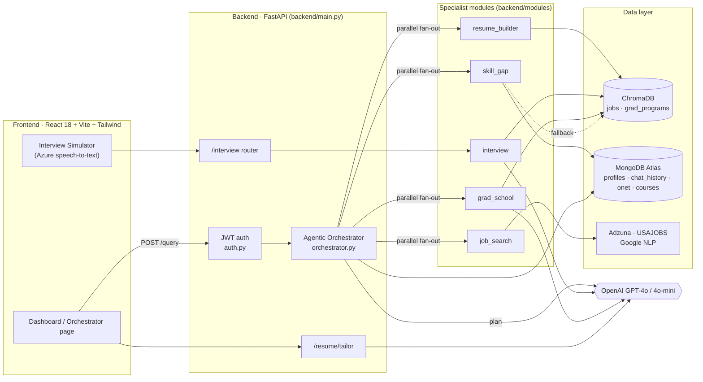
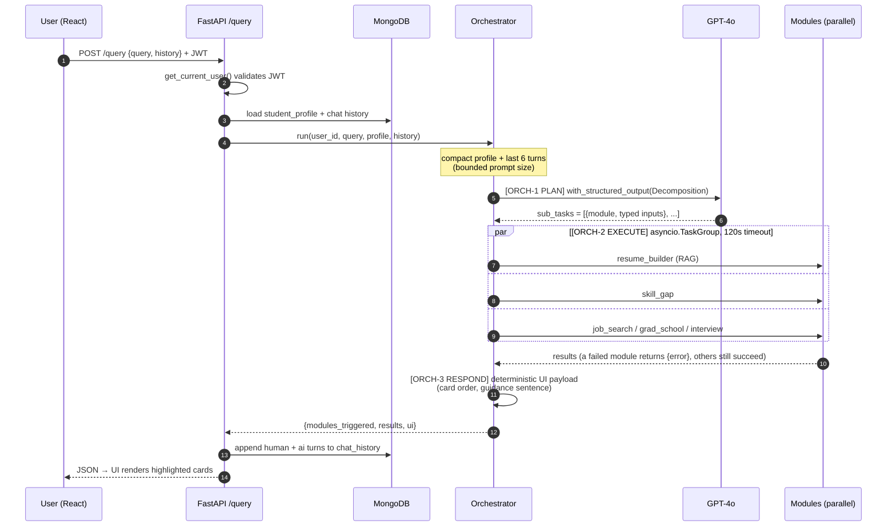
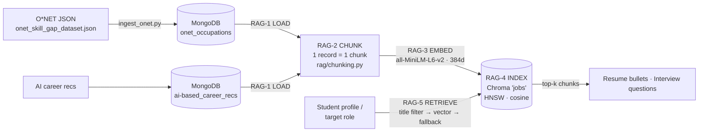
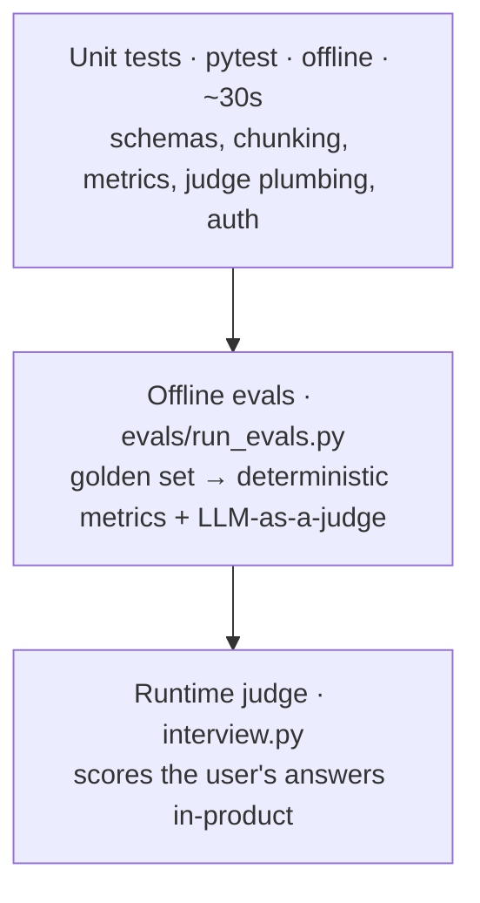

<div align="center">


# **Elevatr**

**An agentic RAG career copilot: one question in, the right specialist tools out.**

`FastAPI` · `LangChain + GPT-4o (structured output)` · `ChromaDB` · `Sentence-Transformers` · `MongoDB Atlas` · `React 18 + TypeScript`

</div>


> **Design doc + code tour.** Each section links to the code that implements it. Searchable tags in the source
> (`[RAG-2 CHUNK]`, `[ORCH-1 PLAN]`, `[LLM-JUDGE]`, …) let you jump straight to a component; see the [Code tour](#10-code-tour-how-to-demo-this-in-10-minutes).

---

## Contents

1. [TL;DR](#1-tldr)
2. [Problem, goals, non-goals](#2-problem-goals-non-goals)
3. [System architecture](#3-system-architecture)
4. [Request lifecycle: `/query`](#4-request-lifecycle-query)
5. [RAG pipeline (ingest → chunk → embed → index → retrieve)](#5-rag-pipeline)
6. [Where LLMs are used, and how output is controlled](#6-where-llms-are-used)
7. [Evaluation: tests, metrics, LLM-as-a-judge](#7-evaluation)
8. [Key design decisions & trade-offs](#8-key-design-decisions--trade-offs)
9. [Known limitations & roadmap](#9-known-limitations--roadmap)
10. [Code tour: how to demo this in 10 minutes](#10-code-tour-how-to-demo-this-in-10-minutes)
11. [Running locally](#11-running-locally)
12. [Repository map](#12-repository-map)

---

## 1. TL;DR

| | |
|---|---|
| **What** | A career-prep platform for students: resume bullets, skill-gap analysis + courses, mock interviews with scored feedback, job search, grad-school matching. |
| **Core idea** | An **agentic orchestrator** turns one free-text request into a typed plan (`Decomposition`) via GPT-4o structured output, then runs only the needed modules **in parallel**. |
| **Grounding** | Modules are grounded in a **ChromaDB** index of O*NET occupation profiles (skills, knowledge, task statements) + career-recommendation records, embedded locally with `all-MiniLM-L6-v2`. |
| **Quality** | 16 offline unit tests + an **eval harness** (`backend/evals/`) measuring routing P/R/F1, retrieval precision@k / MRR, and **LLM-as-a-judge** rubric scores for generated content. |

---

## 2. Problem, goals, non-goals

**Problem.** Students juggle a resume tool, a job board, an interview-practice app and a grad-school spreadsheet, and
none of them know about each other or about what a target role actually requires.

**Goals**
- **G1: One entry point.** A single natural-language box that routes to the right capability(ies).
- **G2: Grounded output.** Recommendations come from real occupational data (O*NET), not model memory.
- **G3: Latency budget.** Multi-intent requests should cost ≈ the slowest module, not the sum of all modules.
- **G4: Measurable quality.** Every LLM-dependent behaviour has an eval, so prompt or model changes can't silently regress.

**Non-goals (for this version)**
- Applying to jobs on the user's behalf.
- Fine-tuning models; we rely on prompting + retrieval + structured output.
- Real-time streaming of partial module results (the UI animates a step list instead).

---

## 3. System architecture



| Component | Responsibility | Code |
|---|---|---|
| **Orchestrator** | Plan → parallel execute → shape UI payload | [backend/orchestrator.py](backend/orchestrator.py) |
| **RAG: chunking** | Turn Mongo records into title-anchored chunks | [backend/rag/chunking.py](backend/rag/chunking.py) |
| **RAG: ingestion** | Mongo → embed → Chroma (offline, idempotent) | [backend/rag/ingestion/ingest_mongo.py](backend/rag/ingestion/ingest_mongo.py) |
| **RAG: retrieval** | Metadata-filtered vector search + fallback | [backend/rag/retriever.py](backend/rag/retriever.py) |
| **Resume builder** | Retrieved occupations × student keywords → bullets | [backend/modules/resume_builder.py](backend/modules/resume_builder.py) |
| **Skill gap** | Required skills vs. student skills → courses | [backend/modules/skill_gap.py](backend/modules/skill_gap.py) |
| **Interview** | RAG-grounded questions + LLM-scored feedback | [backend/modules/interview.py](backend/modules/interview.py), [interview_router.py](backend/modules/interview_router.py) |
| **Job search** | Adzuna + USAJOBS aggregation, scoring, Mongo cache | [job_searchv2.py](backend/modules/job_searchv2.py) (`/job-search`), [job_search.py](backend/modules/job_search.py) (orchestrator) |
| **Grad school** | Program retrieval, fit score, SOP draft | [backend/modules/grad_school.py](backend/modules/grad_school.py) |
| **Resume tailor** | JD keyword extraction → bullet rewrite → PDF | [backend/main.py#L519](backend/main.py#L519) |
| **Persistence** | Profiles, chat history, tailored resumes | [backend/database.py](backend/database.py) |
| **Evals** | Golden set, metrics, LLM-as-a-judge | [backend/evals/](backend/evals/) |

---

## 4. Request lifecycle: `/query`



Key code: [`decompose()`](backend/orchestrator.py#L366) · [`run()`](backend/orchestrator.py#L393) · [`safe_execute_module()`](backend/orchestrator.py#L240) · [`build_ui_payload()`](backend/orchestrator.py#L351) · planner prompt [decomp_prompt.j2](backend/prompts/decomp_prompt.j2)

---

## 5. RAG pipeline



### 5.1 Chunking strategy: record-level, title-anchored · [rag/chunking.py](backend/rag/chunking.py)

The sources are **structured records**, not long prose, so each record becomes exactly one chunk:

```text
Job Title: Data Scientists
Description: Develop and implement a set of techniques or analytics applications ...
Skills: Programming, Mathematics, Critical Thinking, ...
Knowledge: Computers and Electronics, Mathematics, ...
Tasks: Clean and transform data. Build predictive models. ...
```
with metadata `{title, source, mongo_id}`.

| Decision | Why |
|---|---|
| **No fixed-size / sliding-window splits** | Consumers need a *whole* occupation. A fragment saying "SQL" without its job title is useless for "bullets for a Data Scientist". |
| **`Job Title:` header in every chunk** | Anchors each embedding to its role, which improves similarity for role-centric queries. |
| **Title duplicated into metadata** | Enables an exact `where={"title": ...}` pre-filter before vector search. |
| **Most-important-first field order** | `all-MiniLM-L6-v2` only embeds the first **256 word-pieces**; long task lists get truncated *for the embedding* (full text is still stored and returned). |
| **PII dropped** (Name, Age, CandidateID) | No retrieval signal, and it should never leak into generated output. |

**Trade-off / next step:** if task-level recall becomes a problem, split each occupation into an *overview* chunk + *N task* chunks
sharing `mongo_id` (parent-document retrieval), and measure the change with `--suite retrieval`.

### 5.2 Embedding & index · [ingest_mongo.py](backend/rag/ingestion/ingest_mongo.py)

- **Model:** `sentence-transformers/all-MiniLM-L6-v2`: local, free, CPU-fast, 384-d. The **same model** is used at query time.
- **Index:** Chroma `PersistentClient`, collection `jobs`, `hnsw:space = cosine`.
- **Idempotent rebuild:** [`reset_jobs_collection()`](backend/rag/ingestion/ingest_mongo.py#L55) drops and recreates the collection, so re-runs never duplicate chunks.
- **Batched writes** of 2,000 to stay under Chroma's per-call limit.

### 5.3 Retrieval · [retriever.py](backend/rag/retriever.py)

[`query_jobs()`](backend/rag/retriever.py#L33) is a small **hybrid** retriever:
1. **Metadata pre-filter** on `title` (`$eq` / `$in`): precise when the role name is known.
2. **Dense ranking** by cosine similarity.
3. **Fallback** to unfiltered semantic search when the filter matches nothing (e.g. user typed "SWE").

Query construction differs per consumer:
- **Resume** ([`retrieve_for_resume`](backend/rag/retriever.py#L78)): the *whole profile* (skills + coursework + projects + major + role) is embedded as the query.
- **Interview** ([`retrieve_for_interview`](backend/rag/retriever.py#L97)): two intent-phrased queries (tasks vs. questions), `lru_cache`d per job title because every turn re-asks for the same role.

---

## 6. Where LLMs are used

| Where | Model | Purpose | How output is controlled |
|---|---|---|---|
| [`orchestrator.decompose`](backend/orchestrator.py#L366) | gpt-4o | Plan: which modules + inputs | **Pydantic structured output** (`Decomposition`), rules in [decomp_prompt.j2](backend/prompts/decomp_prompt.j2) |
| [`interview.generate_questions`](backend/modules/interview.py) | gpt-4o | Role-specific question | Grounded on RAG tasks + CSV question bank |
| [`interview.generate_feedback`](backend/modules/interview.py#L142) | gpt-4o | **Runtime judge** of the user's answer + strengths/improvements | Anchored 0–1 scale, clamped, blended 60/40 with Google NLP sentiment |
| [`grad_school.generate_sop`](backend/modules/grad_school.py) | gpt-4o-mini | SOP paragraph per program | Retrieved program metadata in prompt |
| [`job_searchv2.extract_job_skills_openai`](backend/modules/job_searchv2.py) | gpt-4o-mini | Skill extraction from postings | `temperature=0` |
| [`/resume/tailor`](backend/main.py#L519) | gpt-4o | JD keywords → bullet rewrites → PDF | Concurrent async calls, Jinja → xhtml2pdf |
| [`evals/judge.py`](backend/evals/judge.py) | gpt-4o (configurable) | **Offline judge** of the system itself | Rubric + reasoning-before-score + structured output, `temperature=0` |

> The resume-bullet module itself is **retrieval + templates, not an LLM**: deterministic, free, and impossible to
> hallucinate skills the student doesn't have. The eval harness measures what that costs in fluency.

---

## 7. Evaluation

Three layers, cheapest first:



### 7.1 Unit tests · `backend/tests/` (no network, no API key)

```bash
cd backend && python -m pytest -q        # 16 passed
```
- [test_evals.py](backend/tests/test_evals.py): metrics math, judge prompt/score plumbing with a **fake LLM**, chunk format + PII drop, the **real** `Decomposition` schema, UI card ordering.
- [test_main.py](backend/tests/test_main.py): `/query` rejects missing or invalid JWTs (401).
- [test_elevatr_components.py](backend/tests/test_elevatr_components.py): structured-output validation pattern, sliding-window history pattern.

### 7.2 Offline eval suites · [backend/evals/](backend/evals/)

| Suite | Question it answers | Ground truth | Metric(s) | Judge? |
|---|---|---|---|---|
| `routing` | Did the planner pick the right modules? | `expected_modules` in [golden_set.json](backend/evals/golden_set.json) | Precision, Recall, F1, exact-match | No (deterministic) |
| `retrieval` | Are the top-k chunks relevant to the role? | Judge labels each chunk relevant / not | **precision@5, hit@5, MRR** | Binary judge |
| `resume` | Are bullets grounded, on-role, ATS-quality? | Student profile as context | Mean 1–5 per criterion | Rubric judge |
| `interview` | Does the feedback scorer rank a strong answer above a weak one, and is the feedback useful? | Paired strong / weak answers | Ranking accuracy + mean 1–5 | Ordering check + rubric judge |

```bash
cd backend
python -m evals.run_evals                                   # all suites
python -m evals.run_evals --suite routing                   # one suite
python -m evals.run_evals --suite retrieval --limit 2 --judge-model gpt-4o-mini   # cheap smoke run
```
Each run writes `backend/evals/results/eval_<timestamp>.json` so runs can be diffed after prompt / model / chunking changes.

### 7.3 LLM-as-a-judge design · [evals/judge.py](backend/evals/judge.py)

| Technique | Why |
|---|---|
| **Explicit rubric with 1 vs 5 anchors** ([`RESUME_BULLET_RUBRIC`](backend/evals/judge.py#L30), [`INTERVIEW_FEEDBACK_RUBRIC`](backend/evals/judge.py#L39)) | Vague "rate the quality" prompts produce unstable scores. |
| **`reasoning` field comes before `score`** in the Pydantic schema | The model commits to evidence first; the number follows from it. |
| **Structured output** (`RubricVerdict`, `RelevanceVerdict`), `score: int = Field(ge=1, le=5)` | Always parseable; out-of-range scores are rejected by validation (unit-tested). |
| **Binary labels for retrieval** | Easier to judge reliably than a graded score; maps directly onto precision@k and MRR. |
| **Ground-truth context in the prompt** | Groundedness is judged against the profile, not the judge's own assumptions. |
| **`temperature=0`, swappable `--judge-model`** | Repeatability; lets you use a different model family than the generator to reduce self-preference bias. |
| **Deterministic checks wherever possible** | Routing and answer-ranking don't need a judge at all, which is cheaper and has no judge variance. |

**Next steps for the judge:** calibrate against ~30 human-labelled examples (Cohen's κ), run each item 3× to measure judge variance, and wire `--suite routing` into CI as a gate.

---

## 8. Key design decisions & trade-offs

| Decision | Alternatives considered | Why this one |
|---|---|---|
| **Structured-output planner** (Pydantic `Decomposition`) | ReAct / tool-calling loop; keyword router | One LLM round-trip with typed inputs: predictable latency and cost, trivially testable. A ReAct loop adds turns we don't need for one-shot routing. |
| **Parallel fan-out** with `asyncio.TaskGroup` + 120s timeout + `safe_execute_module` | Sequential calls | Latency ≈ slowest module (G3). Per-module error isolation means a flaky job API doesn't kill resume output. |
| **Deterministic response shaping** (`build_ui_payload`) instead of a 2nd "synthesis" LLM call | LLM summary ([final_prompt.j2](backend/prompts/final_prompt.j2), earlier design) | Removes a full LLM round-trip and a hallucination surface; the UI renders structured cards anyway. |
| **Local embeddings** (MiniLM) | OpenAI `text-embedding-3-small` | Zero cost and no network at ingest/query; quality is adequate for short, structured chunks. Swap point is a single function. |
| **Record-level chunks** | Fixed 512-token windows | See [§5 RAG pipeline](#5-rag-pipeline). |
| **Template-based resume bullets** (`/query`) + **LLM rewrite** (`/resume/tailor`) | LLM-only bullets | Fast, free, non-hallucinating default; the LLM path is opt-in when the user supplies a real JD. |
| **Context budgeting** (last 6 turns, 1,200-char profile fields) | Send everything | Bounds token cost and latency independent of user data size. |
| **MongoDB for chat history** | Redis (`RedisChatMemory` is implemented) | One fewer service to operate; Redis remains a drop-in for TTL'd, sliding-window session memory at scale. |

---

## 9. Known limitations & roadmap

Being upfront about these is part of the design:

- **Skill-gap requirements** come from a Mongo lookup with a hard-coded fallback list; next step is deriving them from the same O*NET chunks the RAG index uses.
- **Bullet fluency:** template bullets are grounded but formulaic; the `resume` eval's `ats_quality` score is the metric to move.
- **Embedding truncation** at 256 tokens for long O*NET task lists (see §5.1).
- **No reranker:** a cross-encoder rerank over top-20 is the cheapest likely win for precision@5.
- **Legacy files** (`*.old`, `tempCodeRunnerFile.py`, `job_search.py` scraper CLI, `demo.py`) are kept for reference and are not on the request path.
- **Roadmap:** eval gate in CI · parent-document chunking · streaming module results to the UI · human-calibrated judge.

---

## 10. Code tour: how to demo this in 10 minutes

| Min | Show | Open | Talking point |
|---|---|---|---|
| 0–1 | The product | Run the app → `/orchestrator`, ask *"find my skill gaps and write resume bullets for data science"* | Two cards light up from one sentence. |
| 1–3 | **Planning** | [orchestrator.py#L167](backend/orchestrator.py#L167) → [`decompose()`](backend/orchestrator.py#L366) → [decomp_prompt.j2](backend/prompts/decomp_prompt.j2) | Schema-constrained planning; context budgeting. |
| 3–4 | **Parallel execution** | [`run()`](backend/orchestrator.py#L393) | TaskGroup, timeout, failure isolation. |
| 4–6 | **Chunking** | [rag/chunking.py](backend/rag/chunking.py) | Record-level vs fixed windows; 256-token limit; metadata for filtering. |
| 6–7 | **Retrieval** | [`query_jobs()`](backend/rag/retriever.py#L33) | Filter → dense → fallback. |
| 7–9 | **Evaluation** | [judge.py](backend/evals/judge.py) → [run_evals.py](backend/evals/run_evals.py) → [golden_set.json](backend/evals/golden_set.json) | Deterministic where possible, judge where necessary; how you'd trust the judge. |
| 9–10 | **Runtime judge** | [interview.py#L179](backend/modules/interview.py#L179) | LLM score blended with sentiment; the offline judge grades *this* feedback. |

**Jump-to tags:** search the repo (VS Code: `Ctrl+Shift+F`) for:

| Tag | Where |
|---|---|
| `[RAG-1 LOAD]` `[RAG-3 EMBED]` `[RAG-4 INDEX]` | [ingest_mongo.py](backend/rag/ingestion/ingest_mongo.py) |
| `[RAG-2 CHUNK]` | [chunking.py](backend/rag/chunking.py) |
| `[RAG-5 RETRIEVE]` | [retriever.py](backend/rag/retriever.py) |
| `[ORCH-1 PLAN]` `[ORCH-2 EXECUTE]` `[ORCH-3 RESPOND]` | [orchestrator.py](backend/orchestrator.py) |
| `[LLM-JUDGE]` / `[LLM-JUDGE runtime]` | [evals/judge.py](backend/evals/judge.py) / [interview.py](backend/modules/interview.py) |
| `[EVAL]` | [evals/run_evals.py](backend/evals/run_evals.py), [evals/metrics.py](backend/evals/metrics.py) |

---

## 11. Running locally

**Prerequisites:** Python 3.10+ (3.12 tested), Node 18+, a MongoDB Atlas cluster, an OpenAI API key.

```bash
# 1. Configure secrets
cp .env.example .env            # fill in MONGO_URI, OPENAI_API_KEY, JWT_SECRET, ...

# 2. Backend
cd backend
python -m venv venv && source venv/bin/activate      # Windows: venv\Scripts\activate
pip install -r requirements.txt

# 3. Build the RAG index (one-time; re-run after data changes)
python rag/ingestion/ingest_onet.py                  # O*NET JSON → MongoDB
python rag/ingestion/ingest_mongo.py                 # MongoDB → chunks → embeddings → Chroma
python inspect_chroma.py                             # sanity check: doc count + samples

# 4. Run API  →  http://localhost:8000/docs
python -m uvicorn main:app --reload

# 5. Frontend (new terminal)  →  http://localhost:5173
cd frontend && npm install && npm run dev

# 6. Quality
cd backend && python -m pytest -q                    # offline unit tests
python -m evals.run_evals --suite routing            # live eval (needs OPENAI_API_KEY)
```

---

## 12. Repository map

```text
.
├── README.md                     ← you are here (design doc)
├── .env.example                  ← every env var the code reads
├── onet_skill_gap_dataset.json   ← O*NET source data
├── backend/
│   ├── main.py                   ← FastAPI app: auth, profile, /query, /resume/tailor, /job-search
│   ├── orchestrator.py           ← [ORCH-*] plan → parallel execute → UI payload
│   ├── prompts/                  ← Jinja prompt templates (planner)
│   ├── rag/
│   │   ├── chunking.py           ← [RAG-2] chunk builders
│   │   ├── retriever.py          ← [RAG-5] hybrid retrieval
│   │   └── ingestion/            ← [RAG-1/3/4] offline index build
│   ├── modules/                  ← resume_builder · skill_gap · interview · job_searchv2 · grad_school · resume_parser
│   ├── evals/                    ← golden_set.json · metrics.py · judge.py · run_evals.py
│   ├── tests/                    ← pytest (offline)
│   ├── database.py               ← MongoDB + chat memory
│   └── auth.py                   ← JWT dependency
└── frontend/src/
    ├── pages/                    ← Dashboard, Orchestrator, Simulator, JobSearch, Grad, TechStack ...
    ├── components/               ← tiles, ResumeOptimizer, shadcn/ui
    └── hooks/                    ← useInterview, useSpeechToText, use-grad-school
```
